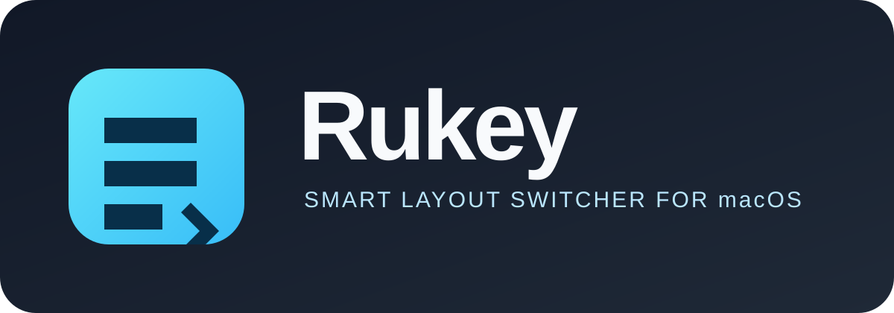

<p align="center">
  
</p>

<p align="center">
  <a href="https://github.com/RomaFka28/rukey/releases/latest"></a>
  <a href="https://github.com/RomaFka28/rukey/actions/workflows/release.yml"></a>
  <a href="LICENSE"></a>
</p>

# Rukey

**Rukey** is a macOS menu bar app that auto-corrects text typed in the wrong keyboard layout (EN ↔ RU), similar to Punto Switcher.

Examples:
- `ghbdtn` → `привет`
- `руддщ` → `hello`

---

## Why use it

- ⚡ Low-latency on-the-fly detection while typing
- 🧠 Undo with one Option tap
- 🛡 Respects Secure Input and app exclusions
- 🔄 Built-in Sparkle auto-updates
- 🖥 Uses the same core engine for GUI and CLI daemon

---

## Install (recommended)

1. Download `Rukey-*.dmg` from the [latest release](https://github.com/RomaFka28/rukey/releases/latest).
2. Drag **Rukey.app** to **Applications**.
3. Launch app and grant permission in<br>
   **System Settings → Privacy & Security → Accessibility**.

After launch, the app runs from the menu bar (no Dock icon).

---

## Usage

### Menu bar app (`Rukey.app`)
- Shows current status and layout
- Lets you open settings and logs
- Supports “Check for Updates…” via Sparkle

### CLI daemon (`rukey`)
```bash
swift run rukey --check-permissions
swift run rukey
swift run rukey --exclude-terminals
swift run rukey --help
```

### Conversion self-check
```bash
swift run rukey --test-conversion
```
Expected output includes 5 lines from the conversion examples.

---

## Configuration

Rukey stores user config in:

- `~/.config/rukey/exclude.json` — exclusions and general settings
- `~/.config/rukey/custom.json` — custom dictionary
- `~/.config/rukey/learned.json` — undo-learning data

These file names and formats are stable for compatibility.

---

## Build from source

Requirements:
- macOS 13+
- Swift 6
- Xcode Command Line Tools

```bash
swift build
swift test
swift run rukey-measure
```

Package app:
```bash
bash tools/package-app.sh
APP_VERSION=1.0.0 bash tools/create-dmg.sh
```

---

## Privacy & safety

- No telemetry
- No network traffic except update checks/downloads via Sparkle
- Secure Input contexts are bypassed automatically

---

## Project structure (short)

- `Sources/RukeyCore/` — detection, conversion, undo, input-source handling
- `Sources/RukeyGUI/` — menu bar UI, settings, update integration
- `Sources/RukeyApp/` — CLI daemon entrypoint
- `Tests/` — unit/integration tests

---

## License

Apache-2.0 — see [LICENSE](LICENSE).
