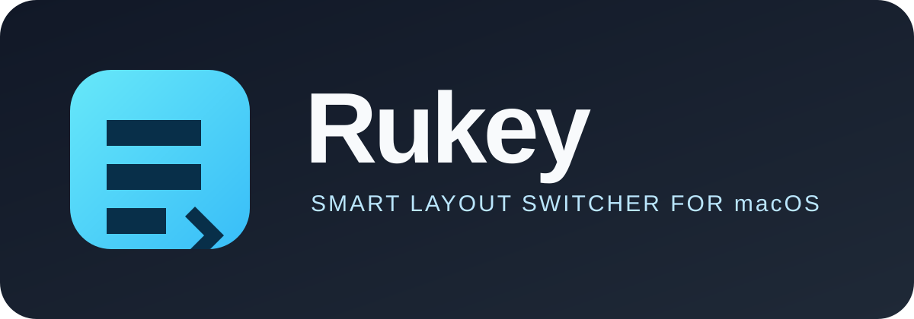

<p align="center">
  
</p>

<p align="center">
  <a href="https://github.com/RomaFka28/rukey/releases/latest"></a>
  <a href="https://github.com/RomaFka28/rukey/actions/workflows/release.yml"></a>
  <a href="LICENSE"></a>
</p>

# Rukey

Автоматическое переключение раскладки клавиатуры на лету на macOS. GUI-версия работает из строки меню (`Rukey.app`), а тот же движок доступен как консольный демон `rukey`.

Примеры исправления:
- `руддщ` → `hello`
- `ghbdtn` → `привет`
- `ghbvth` → `пример`

## Быстрая установка

1. Скачайте `Rukey-*.dmg` из [последнего релиза](https://github.com/RomaFka28/rukey/releases/latest).
2. Откройте архив и перетащите `Rukey.app` в **Applications**.
3. Запустите приложение и дайте доступ в **System Settings → Privacy & Security → Accessibility**.

DMG нужен для обычной установки. Для автоматических обновлений используется отдельный подписанный ZIP и Sparkle appcast.

---

### Для обычного использования

1. Откройте [последний релиз](https://github.com/RomaFka28/rukey/releases/latest).
2. Скачайте `Rukey-*.dmg`.
3. Откройте DMG и перетащите **Rukey** в папку **Applications**.
4. Запустите приложение и выдайте ему доступ в **System Settings → Privacy & Security → Accessibility**.

DMG — удобный установщик для первого запуска. Sparkle использует отдельный
подписанный ZIP внутри релиза, поэтому последующие обновления устанавливаются
автоматически и безопасно.

> **Подпись macOS:** опубликованный релиз собирается с подписью приложения и
> проверкой Sparkle EdDSA. Для снятия предупреждения Gatekeeper на чужих Mac
> нужен отдельный Apple Developer ID Application certificate и notarization.
> Самоподписанный сертификат проекта предназначен для локальной разработки и CI.

### Для разработчиков

```bash
bash tools/package-app.sh
APP_VERSION=1.0 bash tools/create-dmg.sh
open dist/Rukey-1.0.dmg
```

Исходный код распространяется по [Apache License 2.0](LICENSE).

---

## Архитектура и ключевые компоненты

1. **Низкоуровневый системный перехват (`EventTapManager`)**
   - Использует `CGEventTap` (`.cgSessionEventTap` на `headInsertEventTap`).
   - Накапливает символы в буфер слова (`BufferManager`).
   - Сбрасывает буфер при нажатии клавиш-разделителей (пробел, Enter, Tab, Escape, стрелки) и служебных модификаторов (`Cmd`, `Ctrl`, `Alt/Option`).

2. **Префиксный детектор (`Detector` & `Trie`)**
   - Быстрое префиксное дерево (Trie) с поиском за $O(L)$, где $L$ — длина префикса.
   - Встроенные словари частотных слов: **46297 слов EN** (`words_en.txt`) и **48197 слов RU** (`words_ru.txt`).
   - При наборе каждого символа (начиная с длины 3) проверяется, валиден ли префикс в текущем языке и является ли он началом слова в противоположной раскладке.
   - На границе слова (пробел, Enter и т.д.) дополнительно вызывается `evaluateFullWord` — проверка целого слова (минимум 2 символа).
   - Задержка оценки префикса составляет **~1.2 микросекунды на нажатие клавиши** (low latency).

3. **Атомарное исправление (`FixEngine`)**
   - **Suppress**: на время операции выставляется флаг `isSuppressingInput`; события **не блокируются**, а просто пропускаются как есть (pass-through), чтобы не задерживать пользовательский ввод.
   - **Стирание**: отправка точного количества синтетических `Backspace` через `CGEventSource` (`.cghidEventTap`).
   - **Смена раскладки**: программное переключение источника ввода через `TISSelectInputSource` на целевой язык.
   - **Вставка**: системная вставка декодированной строки целиком через Unicode String API (`keyboardSetUnicodeString`), исключающая рассинхронизацию раскладки и экрана.
   - **Восстановление**: сброс флага `isSuppressingInput`.

4. **Undo и переключение по Option (`RukeyUndoManager`)**
   - **Option-undo**: если для последней автозамены доступно состояние отмены, одиночный тап `Option` перехватывается как команда отмены; состояние расходуется при использовании и сбрасывается на границе слова (пробел, Enter, Tab), клике, Backspace или сбросе буфера.
   - Точный пересчет арифметики символов с учетом напечатанного после замены хвоста.
   - Возврат исходного текста и восстановление изначальной раскладки; состояние undo сбрасывается после срабатывания.
   - **Option-toggle**: одиночный тап `Option` без доступного undo переключает раскладку EN ↔ RU (через `InputSourceManager.apply(language: to)` из `EventTapManager.handleOptionTap`). Тап `Option` в сочетании с другой клавишей (⌥e → é и т.п.) переключение не вызывает.
   - **Delete**: всегда работает как обычный Backspace — удаляет символ, уменьшает буфер и **сбрасывает состояние undo** (автозамена через Delete не откатывается).

5. **Безопасность и исключения (`SecureInputMonitor`)**
   - Мониторинг `IsSecureEventInputEnabled()`: мгновенный обход перехвата в полях ввода паролей и системных защищенных диалогах.
   - Всегда пропускаются менеджеры паролей: 1Password, KeePassXC, Bitwarden, LastPass, Keychain Access.
   - **Автоматический пропуск терминалов** (Terminal, iTerm2, Alacritty, Kitty, Ghostty, Termius) — включается флагом `--exclude-terminals` или галочкой «Не трогать терминалы» в настройках GUI (вкладки «Приложения» и «Общее»). Галочка записывается в `exclude.json` (`excludeTerminals`) и через общий конфиг действует и в консольном режиме. По умолчанию (ни флага, ни галочки) терминалы автокорректируются как обычно.

---

## Сборка и запуск

### Требования
- macOS 13.0+
- Swift 6.0+ / Xcode Command Line Tools

### Тесты и бенчмарк
```bash
# Полный прогон тестов (нужен полный Xcode — XCTest не входит в Command Line Tools)
swift test

# Контрольный прогон движка и бенчмарк (без XCTest)
swift run rukey-measure
```

### Сборка приложения
```bash
# Один раз: создать самоподписанный сертификат «Rukey Local Signing»
bash tools/make-signing-cert.sh

# Собрать и подписать приложение
bash tools/package-app.sh
# → dist/Rukey.app
```

`tools/package-app.sh` собирает релизную `RukeyGUI`, укладывает `dist/Rukey.app` (вместе со словарями) и подписывает бандл с hardened runtime идентичностью «Rukey Local Signing». Скрипты идемпотентны: повторный запуск пересобирает и переподписывает тот же бандл, идентификатор и сертификат не меняются — поэтому выданные права Accessibility переживают пересборку. Если системная настройка доверия к сертификату не добавлена, `make-signing-cert.sh` нужно запустить из обычного окна Terminal и подтвердить запрос. Подпись требует доверенной идентичности (`security find-identity -v -p codesigning`); без неё `package-app.sh` отказывается упаковывать и подписывать бандл.

### Автообновления

GUI использует Sparkle 2.10.1. Обновления принимаются только из GitHub Releases и
только после проверки EdDSA-подписи Sparkle. Ветка `main` и обычный GitHub ZIP
не устанавливаются автоматически.

Для настройки обновлений один раз:

1. Создайте ключи Sparkle утилитой `generate_keys`.
2. Сохраните приватный ключ в GitHub Secret `RUKEY_SPARKLE_PRIVATE_KEY`.
3. Поместите публичный ключ в `Sources/RukeyGUI/Resources/Info.plist` вместо
   `REPLACE_WITH_SPARKLE_PUBLIC_KEY`.
4. Сохраните signing certificate приложения в secrets
   `RUKEY_SIGNING_CERTIFICATE_BASE64` и
   `RUKEY_SIGNING_CERTIFICATE_PASSWORD`.
5. Создайте релиз тегом:

```bash
git tag v1.0.1
git push origin v1.0.1
```

GitHub Actions соберёт подписанный `.app`, создаст `appcast.xml` и опубликует
релиз. В меню Rukey появится пункт «Проверить обновления…», а Sparkle сможет
проверять обновления в фоне и перезапускать приложение после установки.

Получить ключи локально можно после сборки Sparkle:

```bash
find .build -name generate_keys -type f -print -quit
./.build/artifacts/sparkle/Sparkle/bin/generate_keys
./.build/artifacts/sparkle/Sparkle/bin/generate_keys -x /tmp/rukey-sparkle-private-key
```

Содержимое `/tmp/rukey-sparkle-private-key` добавьте в GitHub Secret
`RUKEY_SPARKLE_PRIVATE_KEY`, затем удалите временный файл. Приватный ключ
нельзя коммитить или публиковать. Для GitHub Actions также нужны:

- `RUKEY_SIGNING_CERTIFICATE_BASE64` — base64 от `.p12` сертификата подписи
  приложения;
- `RUKEY_SIGNING_CERTIFICATE_PASSWORD` — пароль этого `.p12`.

### Первый запуск и права Accessibility
- `open dist/Rukey.app` (или двойной клик) — приложение стартует без окна консоли и без значка в Dock: в строке меню появляется иконка-молния.
- У приложения есть отдельная иконка Finder/Dock; иконка в строке меню остаётся компактной template-иконкой.
- Без прав Accessibility строка статуса красная — «Нет прав Accessibility»; приложение продолжает работать и ждёт. Права выдаются в **System Settings → Privacy & Security → Accessibility**; опрос идёт раз в 2 секунды, так что выдача подхватывается без перезапуска приложения.
- Если права есть, но перехват не стартовал, статус — красное «Не запущено»; причина записывается в «Журнал».
- Пока прав нет, нужный раздел System Settings открывает пункт «Открыть настройки Accessibility» прямо в меню (само окно настроек до выдачи прав не открывается — оно строится после получения прав). После выдачи прав тот же раздел открывает одноимённая кнопка на вкладке «Общее».

### Меню и настройки
Меню в строке меню: статус, текущая раскладка, последняя автозамена, баннер «Запомнено: … больше не станет …» (с командой «Убрать»), галочка «Автозапуск при входе», «Настройки…», «Журнал…», «Выйти». Когда слово запоминается, примерно на секунду мигает иконка (заливка меняется на контур), а после автозамены в правом верхнем углу на ~1,5 секунды может появиться панель «исходное → исправленное».

Окно настроек — четыре вкладки:
- **Слова** — «Не заменять» (эти слова не конвертируются) и «Мои слова» (эти слова считаются правильными, даже если их нет во встроенных словарях).
- **Приложения** — bundle ID приложений, в которых Rukey не вмешивается, с выбором из установленных приложений и галочкой «Не трогать терминалы» (Terminal, iTerm2 и другие из встроенного списка).
- **Общее** — минимальная длина префикса (2–5), порог автообучения (0, 2, 3 или 5), «Уведомлять о каждой отмене», «Показывать всплывашку после автозамены», «Не трогать терминалы», «Автозапуск при входе» и кнопка раздела Accessibility.
- **Журнал** — строки журнала с временем и уровнем, фильтр «Все уровни / Только ошибки» и кнопка «Копировать».

Системные уведомления (об отмене и о запоминании слова) работают только у собранного `Rukey.app`: центру уведомлений нужен настоящий бандл.

### Файлы конфигурации
- `~/.config/rukey/exclude.json` — основные настройки: `excludedWords` и `excludeBundleIDs` (вкладки «Слова» и «Приложения»), `excludeTerminals`, `launchAtLogin`, `autoLearnThreshold`, `notifyOnEveryUndo`, `showCorrectionFlash`, `minPrefixLength` (вкладка «Общее»). Файл можно править вручную; неразбираемый JSON игнорируется с предупреждением в журнале, а недопустимые числовые значения откатываются к значениям по умолчанию.
- `~/.config/rukey/custom.json` — «Мои слова».
- `~/.config/rukey/learned.json` — счётчики отмен для автообучения; удаление слова из «Не заменять» очищает их, чтобы слово можно было выучить заново.

«Автозапуск при входе» пишет `~/Library/LaunchAgents/com.roman.rukey.plist` (`RunAtLoad`); выключение удаляет файл.

### Консольный режим
Тот же движок доступен как консольный демон — без иконки в строке меню, с теми же файлами конфигурации:

```bash
# Проверка прав Accessibility
swift run rukey --check-permissions

# Запуск демона (терминалы НЕ пропускаются)
swift run rukey

# Запуск с пропуском терминалов
swift run rukey --exclude-terminals

# Пропуск конкретного приложения по bundle ID (флаг повторяемый)
swift run rukey --exclude-bundle com.example.app

# Подробный отладочный журнал (кратко: -v)
swift run rukey --verbose

# Справка по всем флагам (кратко: -h)
swift run rukey --help
```

### Оффлайн-проверка конверсий
```bash
swift run rukey --test-conversion
```
Ожидаемые пять строк:
```
Input: 'руддщ' [ru] -> Kept as is
Input: 'ghbdtn' [en] -> Corrected to 'привет' [ru] (rule: en_invalid_prefix_ru_valid)
Input: 'ghbvth' [en] -> Corrected to 'пример' [ru] (rule: en_invalid_prefix_ru_valid)
Input: 'hello' [en] -> Kept as is
Input: 'привет' [ru] -> Kept as is
```
